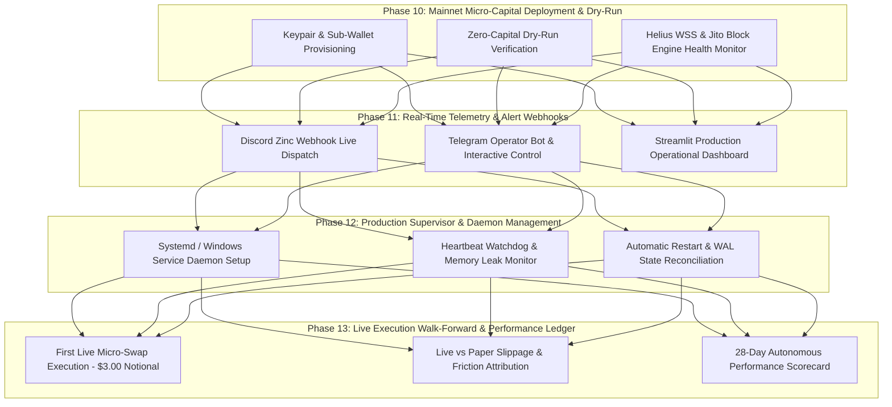

# Funbot Systematic Solana Momentum Engine — Project Roadmap

## Milestone Registry

| Milestone | Version | Focus | Status | Reference |
|---|---|---|:---:|---|
| **Milestone 1** | v1.0 | Observational Telemetry & Falsification Architecture | **ARCHIVED & PASSED** | [v1.0-ROADMAP.md](file:///c:/Users/sivab/Documents/products/funbot/.planning/milestones/v1.0-ROADMAP.md) |
| **Milestone 2** | v3.0 | Live Execution Engine & Production Orchestration | **ARCHIVED & PASSED** | [v3.0-ROADMAP.md](file:///c:/Users/sivab/Documents/products/funbot/.planning/milestones/v3.0-ROADMAP.md) |
| **Milestone 3** | v4.0 | Autonomous Mainnet Live Execution & Micro-Capital Trading | **ACTIVE / READY FOR PLANNING** | Phases 10–13 (Below) |

---

## Milestone 3: Autonomous Mainnet Live Execution & Micro-Capital Trading

**Objective:** Deploy the audited live execution engine into continuous, autonomous production operation on Solana Mainnet with segregated micro-capital ($25 active bankroll, $75 cold reserve), real-time push alerts, and automated 24/7 supervisor monitoring.

### Phase Dependency & Architecture Graph

---

### Phase 10: Mainnet Micro-Capital Deployment & Dry-Run
**Focus:** Sub-wallet provisioning, zero-capital live wire dry-runs, and network latency baselining.
- **Goals:**
  - Initialize the segregated sub-wallet with $25.00 SOL allocation and verify Section 7.1 reserve protection ($75.00 untouched).
  - Execute end-to-end dry-run wire transaction assembly and Jito simulation against live mainnet blockhashes without broadcasting funds.
  - Baseline live WebSocket latency from Helius and Jito block engine response times.
- **Status:** **COMPLETED & VERIFIED** (13/13 tests passing)

---

### Phase 11: Real-Time Telemetry & Operator Webhooks
**Focus:** Live operator alert channels, Discord visual embeds, Telegram remote commands, and Streamlit monitoring.
- **Goals:**
  - Activate live push webhooks for Discord and Telegram on entry qualification, trailing ratchet updates, and position exits.
  - Wire interactive emergency commands (`/kill`, `/status`, `/circuit_breaker`) via Telegram operator bot.
  - Connect Streamlit Live Terminal tab with real-time SQLite WAL streaming.
- **Status:** READY FOR PLANNING

---

### Phase 12: Production Supervisor & Daemon Management
**Focus:** Autonomous process lifecycle, background daemonization, memory monitoring, and watchdog restarts.
- **Goals:**
  - Configure production supervisor service (Windows Service / systemd script) for non-stop autonomous operation.
  - Implement periodic heartbeat ping and memory/resource watchdog.
  - Verify reboot recovery: automatically re-read SQLite WAL state and query wallet SPL balances.
- **Status:** PENDING PHASE 11

---

### Phase 13: Live Execution Walk-Forward & Performance Ledger
**Focus:** First live micro-trades, real-world fee/slippage benchmarking, and walk-forward validation scorecard.
- **Goals:**
  - Execute live test trade ($3.00 notional) adhering to the 12-Check Gate and Path A+ dynamic trailing stop.
  - Compare live fill prices against AMM quote calculator to record real-world slippage and MEV sandwich resistance.
  - Track 28-day autonomous PnL scorecard with cumulative return, drawdown, and win rate.
- **Status:** PENDING PHASE 12
