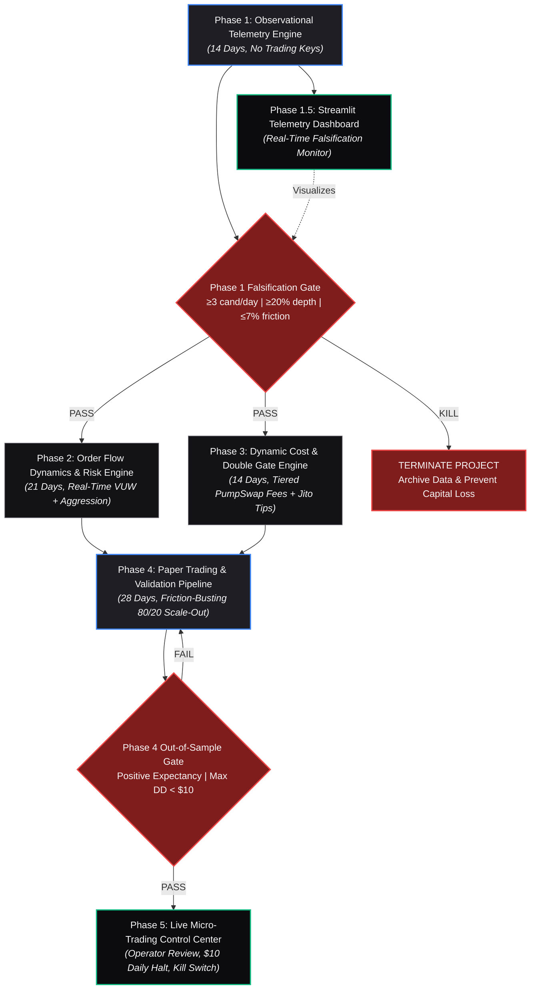

# Project Roadmap & Phase Dependency Analysis (v2.5)

**Milestone:** Post-Graduation Momentum System — Falsification & Observational Architecture  
**Active Baseline:** `bot.md` (v2.5) & `build.md` (v2.5)  
**Analyzed Under:** `/gsd-analyze-dependencies` & `/building-data-apps`  

---

## 1. Phase Dependency Graph Overview

The system is partitioned into sequential and staggered phases governed by hard falsification gates. Under no circumstances may execution code proceed if an upstream observational gate fails.



---

## 2. Phase-by-Phase Dependency & Coupling Matrix

### Phase 1: Observational Telemetry Engine (14 Days)
* **Depends on:** `None` (Root Phase)
* **File Footprint:**
  * `src/telemetry/pool_discovery.py`
  * `src/telemetry/state_tracker.py`
  * `src/telemetry/flow_telemetry.py`
  * `src/telemetry/feed_audit.py`
  * `src/telemetry/watchlist.py`
  * `phase1_falsification_gate.py`
  * `data/telemetry/`
* **Data Flow Produced:**
  * Canonical pool migration events (`token_mint`, `migration_ts`, `sol_reserve`, `token_reserve`).
  * Rolling flow statistics at 10s, 30s, 60s (volume, unique wallets, buy/sell ratios).
  * Post-graduation age tracking (0–5m, 5–8m BOOST cliff, 8–25m secondary window).
  * 14-day aggregate JSON/Parquet logs for gate verification.
* **Semantic API Exposed:**
  * `PoolDiscoveryStream.on_migration(callback)`
  * `WatchlistManager.get_active_candidates(window=(8, 25))`
  * `FlowMetrics.get_rolling_window(mint, seconds=60)`
* **Invariants Enforced:** Guardrail 1 (8–25m window only) and Guardrail 3 (bypassing 0–5m BOOST cliff).

---

### Phase 1.5: Observational Telemetry Data App (Streamlit)
* **Depends on:** `Phase 1` (Telemetry data schemas & active stream)
* **File Footprint:**
  * `src/ui/app.py`
  * `src/ui/components/kpi_cards.py`
  * `src/ui/components/candidate_table.py`
  * `src/ui/components/cliff_charts.py`
  * `src/ui/styles.py`
* **Rationale & Architecture:**
  * **Framework Selected:** **Streamlit** (per `/building-data-apps` standards; seamlessly fits the active Python data ecosystem and EDR Terminal conventions on port 8501).
  * **Visual Hierarchy:** Zinc dark palette (`#09090b` canvas, `#0c0c0f` bordered cards, `DM Sans` + `JetBrains Mono` typography, minimal chrome).
  * **Role in Pipeline:** Provides continuous visual feedback during the 14-day Phase 1 window. Prevents operator blindness by surfacing live candidate density, depth absorption, and friction pass rates in real time.
* **Semantic Consumed:** Reads `data/telemetry/` and subscribes to `WatchlistManager`.

---

### Phase 2: Cluster Analyzer & Risk Scoring Engine (21 Days)
* **Depends on:** `Phase 1` (Must pass Phase 1 Falsification Gate)
* **File Footprint:**
  * `src/cluster/funding_graph.py`
  * `src/cluster/risk_scoring.py`
  * `src/cluster/burner_detection.py`
  * `src/cluster/sybil_heuristics.py`
  * `src/cluster/safety_checks.py`
  * `data/cluster/`
* **Coupling & Overlap with Phase 1:**
  * **Data Dependency:** Consumes unique buyer public keys from Phase 1 flow telemetry.
  * **Semantic Dependency:** Wraps candidate tokens from Phase 1 and decorates them with `cluster_risk_score`, `burner_ratio`, and `safety_flag`.
* **Invariants Enforced:** Invariant 5 (Real-Time AMM Order Flow Dynamics: VUW $\ge 1.20$, Aggression Ratio $> 2.00$; legacy 2-hop funding graph and <3 tx checks dead) and Guardrail 7 (mint & freeze authority verification).

---

### Phase 3: Dynamic Cost Engine & Pre-Flight Double Gate (14 Days)
* **Depends on:** `Phase 1` (Passed Gate), `Phase 2` (Cluster filter input)
* **Can run in parallel with:** Phase 2 (develop models concurrently once Phase 1 schemas exist, but integration requires Phase 2 flags).
* **File Footprint:**
  * `src/cost/fee_tiers.py`
  * `src/cost/slippage_model.py`
  * `src/cost/jito_tips.py`
  * `src/cost/failure_penalties.py`
  * `src/cost/double_gate.py`
  * `config/fee_schedule.yaml`
  * `config/risk_limits.yaml`
* **Coupling & Overlap:**
  * **Data Dependency:** Consumes empirical depth and reserve snapshots from Phase 1 to fit the slippage model.
  * **Semantic Dependency:** Exposes `evaluate_preflight_double_gate(pool_state, cluster_score) -> GateResult`.
* **Invariants Enforced:** Invariant 4 (Pre-Flight Double Gate: $C_{\text{expected}} \le 7.0\% / 6.0\%$, stress cost $\le 10\%$, legacy Ratchet Triggers dead, replaced by +8% to +10% TP1 Friction Buster), Capital Allocation (Dynamic Liquidity-Based Sizing capped at $25, floor $3.00), and Guardrail 6 (1.5% notional tip cap).

---

### Phase 4: Paper Trading Pipeline & Out-of-Sample Falsification (28 Days)
* **Depends on:** `Phase 1`, `Phase 2`, `Phase 3` (Strict full dependency)
* **File Footprint:**
  * `src/engine/paper_ledger.py`
  * `src/engine/simulator.py`
  * `src/engine/validator.py`
  * `src/engine/hit_rate_surface.py`
  * `src/engine/risk_monitor.py`
  * `data/paper/`
* **Coupling & Overlap:**
  * **Integration Hub:** Glues telemetry signals, cluster safety, and dynamic cost accounting into a deterministic paper execution engine.
  * **Data Flow Consumed:** Full historical stream split 60% in-sample / 40% chronologically contiguous out-of-sample.
* **Invariants Enforced:**
  * Guardrail 2: **Friction-Busting Scale-Out (Modified Path B)**. Path A+ prohibited for positions < $50. Two-stage exit: TP1 (80% at +8%–+10% gross) covers round-trip friction; remaining 20% free runner trails with a 15% stop with zero cost-of-capital drag.
  * Guardrail 7: Enforces $10 maximum daily loss capacity and 20-minute fallback holding timeout.

---

### Phase 5: Live Micro-Trading Control Center & Execution Bridge (Ongoing)
* **Depends on:** `Phase 4` (Must satisfy Phase 4 Out-of-Sample Gate)
* **File Footprint:**
  * `src/live/jito_bundle_builder.py`
  * `src/live/execution_bridge.py`
  * `src/live/kill_switch.py`
  * `src/ui/pages/live_control.py`
* **Coupling & Overlap:**
  * Wraps `src/engine/simulator.py` logic with actual Solana wallet transactions.
  * Updates Streamlit UI with live P&L, position health, and manual emergency liquidation controls.
* **Invariants Enforced:** Atomic bundle transaction ordering (tip after swap), 0.005 SOL emergency exit budget, hard daily halt at -$10.00 realized loss.

---

## 3. Parallel Execution & Critical Path Matrix

| Phase | Start Prerequisite | Parallelization Potential | Critical Path? |
| :--- | :--- | :--- | :--- |
| **Phase 1** (Telemetry) | Immediate | Standalone | **YES (Bottleneck)** |
| **Phase 1.5** (UI Dashboard) | Day 3 of Phase 1 | Runs parallel with Phase 1 data collection | NO (Enhancement) |
| **Phase 2** (Cluster Analyzer) | Phase 1 Gate = PASS | Can develop in parallel with Phase 3 | **YES** |
| **Phase 3** (Cost Engine) | Phase 1 Gate = PASS | Can develop in parallel with Phase 2 | **YES** |
| **Phase 4** (Paper Trading) | Phase 2 & 3 Complete | Pipeline integration, no parallelization | **YES** |
| **Phase 5** (Live Pilot) | Phase 4 Gate = PASS | Final milestone stage | **YES** |

**Total Calendar Timeline:**
- Phase 1: 14 calendar days (observational data gathering cannot be accelerated).
- Phase 2 & Phase 3: 21 calendar days (run with staggered concurrency).
- Phase 4: 28 calendar days (40–60 trading day simulation equivalent).
- **Minimum time to Live Decision:** ~63 days.

---

## 4. UI Architecture & Data App Specification (Streamlit)

Adhering to `resources/shared_design_system.md` and `resources/streamlit_framework.md`:

```
┌─────────────────────────────────────────────────────────────────────────────┐
│  ◆ PUMP.FUN POST-GRADUATION TELEMETRY TERMINAL              [☀️ Light / 🌙 Dark] │
├─────────────────────────────────────────────────────────────────────────────┤
│  [KPI 1: Candidate Supply]   [KPI 2: Depth Pass Rate]   [KPI 3: Avg Friction] │
│      4.2 / day (PASS)             28.4% (PASS)               5.82% (PASS)   │
├─────────────────────────────────────────────────────────────────────────────┤
│  [Tabs: 1. Watchlist & Feed | 2. Cliff Decay | 3. Falsification Gate | 4. Risk] │
├─────────────────────────────────────────────────────────────────────────────┤
│  ┌───────────────────────────────┐  ┌────────────────────────────────────┐  │
│  │ Active Candidates (8–25m)     │  │ BOOST Buyback Cliff Decay Curve    │  │
│  │ Token | MC Tier | Age | Status│  │ Volume collapse at min 5-8 vs 8-25 │  │
│  │ (JetBrains Mono tabular card) │  │ (Plotly themed container)          │  │
│  └───────────────────────────────┘  └────────────────────────────────────┘  │
└─────────────────────────────────────────────────────────────────────────────┘
```

* **Styling Tokens:**
  * Background: `#09090b` (Dark) / `#ffffff` (Light)
  * Cards: `#0c0c0f` (Dark) with `1px solid #1e1e24` border
  * Accent: `#2563eb` (Blue), Success: `#22c55e`, Alert: `#ef4444`, Warning: `#f59e0b`
  * Typography: `DM Sans` for labels/headers, `JetBrains Mono` for addresses, SOL, percentages
* **Data Sources:** Real-time tailing of local SQLite/Parquet files populated by `src/telemetry/`.

---

## 5. Gemini Data Analytics Chat Interface — Implementation Plan

Per `/building-data-apps` standards (`resources/chat_integration.md`), an interactive conversational layer enables natural language queries against the 14-day telemetry dataset, falsification metrics, and simulated paper trade records.

### 5.1 Architecture & Technical Requirements
1. **Thought vs. Content Segregation:**
   * Stream raw LLM thought traces separately from final response bubbles.
   * Render thoughts in a subtle zinc disclosure pill (`var(--text-dim)`) with real-time streaming updates.
2. **Server-Sent Streaming & Multi-Turn Context:**
   * Multi-turn conversational memory tracking prior queries and dataset context.
   * Streaming generator rendering tokens as they arrive.
3. **Interactive Suggestions (`SUGGESTION` pills):**
   * Context-aware follow-up queries generated after each answer (e.g., *"Filter by Regime B only"*, *"Plot slippage vs reserve for top pool"*, *"Check cliff survival rate"*).
4. **Data Source Integration:**
   * **Local Mode (Default):** Dual-engine SQLite / DuckDB tool layer executing exact SQL queries over `data/telemetry/telemetry.db` and `pools_observed.parquet`.
   * **GCP BigQuery Mode (Optional):** Integration with `google.cloud.geminidataanalytics_v1beta.DataChatServiceClient` when GCP credentials and BigQuery tables are provided.
5. **Theme Synchronization:**
   * Full alignment with the Zinc dark/light theme and JetBrains Mono code styling.

### 5.2 Implementation Deliverables (Phase 1.5)
* `src/ui/components/chat_panel.py`: Streamlit chat UI with message bubbles, collapsible thoughts, and dynamic suggestion chips.
* `src/ui/chat_backend.py`: Query generator translating natural language to deterministic SQL / Pandas queries over telemetry logs.
* `tests/unit/test_chat_backend.py`: Verification of SQL generation safety (read-only enforcement) and multi-turn context retention.

### 5.3 Acceptance & Validation Checklist
- [ ] Is the chat interface functional and responding to questions against telemetry data?
- [ ] Does it support multi-turn follow-up questions?
- [ ] Are responses rendered in clean GitHub-flavored markdown with code blocks?
- [ ] Are reasoning thoughts segregated from the final response bubble?
- [ ] Are thought streams displayed with active progress indicators?
- [ ] Are interactive follow-up suggestions rendered as clickable prompt buttons?
- [ ] Are all queries strictly read-only with zero risk of database corruption?

